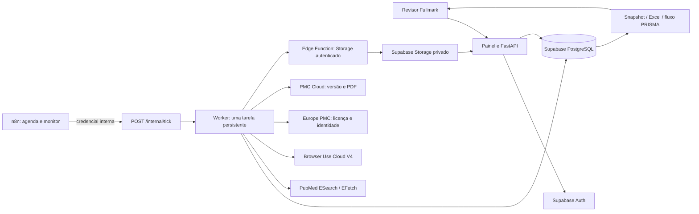

# Arquitetura e contrato da API

## Componentes

API e worker são o mesmo código. Em modo econômico, o n8n chama o endpoint interno para executar uma tarefa por chamada. Em modo contínuo, um processo separado executa `python -m app.worker`. O banco é a fonte de verdade, sem Redis nem fila em memória. Sessões n8n, conexões do Codex e chaves da aplicação são credenciais distintas.

## Modelo de dados

| Tabela | Finalidade |
|---|---|
| fm_reviews | Proprietário, título, protocolo imutável, hash e aprovação |
| fm_searches | String exata, tradução PubMed, limite, total encontrado e resposta original |
| fm_articles | Referência canônica por DOI/PMID, sugestão, PDF e extração |
| fm_records | Cada ocorrência em cada busca, vinculada à referência canônica |
| fm_decisions | Decisões humanas por etapa, sem sobrescrita |
| fm_audit | Eventos de protocolo, busca, sugestões, decisões e falhas |
| fm_jobs | Fila, chave de idempotência, tentativas, lease, ID de fornecedor e estado |
| fm_schema_migrations | Histórico operacional do executor de migrações |

Deduplicação: DOI normalizado; na ausência dele, PMID. PMID também reconcilia registros cujo DOI foi enriquecido. Título semelhante nunca é motivo suficiente para fusão automática. Ocorrências originais ficam preservadas. Várias publicações do mesmo estudo continuam sendo relatórios separados até agrupamento humano, que não está implementado como entidade neste MVP.

## Autenticação e autorização

Login usa Supabase Auth; o backend valida cada access token com `/auth/v1/user`. Não aceita claims de usuário sem validação remota e não usa `user_metadata` para autorização. A interface mantém tokens apenas na memória; o refresh token permite renovar a sessão durante o uso e é descartado ao sair/recarregar.

Todas as operações de pesquisa verificam `owner_id`. Revisores diferentes não compartilham pesquisas neste MVP. O projeto Supabase deve ter cadastro público desabilitado e contas convidadas pela Fullmark. A API aplica autorização também ao operar com o papel dedicado de backend, restrito às tabelas do aplicativo. A credencial interna só permite executar/consultar a fila; não aprova protocolos nem decisões.

RLS está ativo em todas as tabelas. `authenticated` tem somente SELECT por proprietário; `anon` não tem acesso. Escrita ocorre pelo backend autorizado. Storage privado usa caminhos `owner_id/review_id/...`; leitura direta é limitada ao proprietário, escrita cliente negada. Secret key e conexão Postgres nunca chegam à interface.

Auditoria e decisões têm triggers que recusam UPDATE/DELETE. Isso previne sobrescrita por código de aplicação; não constitui registro inviolável contra um administrador do banco, que pode alterar a infraestrutura. A aprovação do protocolo é registrada uma vez e protegida contra alterações.

## Endpoints principais

Todos os endpoints de pesquisa exigem `Authorization: Bearer <access_token do Supabase>`.

| Método / caminho | Comportamento |
|---|---|
| GET /health/live | Processo responde |
| GET /health/ready | Banco e tabela principal acessíveis |
| POST /auth/login | Login email/senha no Supabase |
| POST /auth/refresh | Renovação de sessão no Supabase |
| GET, POST /reviews | Listar/criar pesquisas do proprietário |
| GET /reviews/{rid} | Snapshot completo do proprietário |
| POST /reviews/{rid}/approve | Aprovar protocolo imutável |
| POST /reviews/{rid}/searches | Enfileirar PubMed; header Idempotency-Key obrigatório |
| POST /reviews/{rid}/browser | Enfileirar sugestões V4; mesma exigência de idempotência |
| POST /reviews/{rid}/articles/{aid}/decisions | Decisão humana de título/resumo ou texto completo |
| POST /reviews/{rid}/articles/{aid}/extraction | Campos com valor, página e citação literal conferida |
| GET /reviews/{rid}/articles/{aid}/pdf | PDF privado via backend autenticado |
| GET /reviews/{rid}/prisma | Contagens com pendências e motivos |
| GET /reviews/{rid}/export/{xlsx,svg,json} | Arquivo correspondente ao snapshot atual |
| POST /reviews/{rid}/jobs/{jid}/retry | Retentar tarefa com falha |
| POST /reviews/{rid}/jobs/{jid}/reconcile | Vincular execução Browser Use existente após resposta ambígua |
| POST /internal/tick | Executar uma tarefa; X-Internal-Token obrigatório |
| GET /internal/queue | Contagens operacionais; mesma credencial interna |

OpenAPI interativo em `/docs`. O contrato é gerado pelo FastAPI. O executor de exportações usa strings inline OOXML para impedir que títulos ou citações com `=` se tornem fórmulas. Células longas são limitadas ao teto do Excel de 32.767 caracteres; o JSON é a fonte completa sem esse limite por célula.

## Estados da fila e resiliência

`pending → running → done`; erros retomam `pending` com backoff e param em `failed` após três tentativas. Claim PostgreSQL usa `FOR UPDATE SKIP LOCKED`, atualização condicional e lease de 300 s. Uma tarefa interrompida pode ser retomada após expirar o lease. Um advisory lock por banco serializa chamadas PubMed dos workers deste MVP.

PubMed e PDF podem repetir uma tentativa; gravações são idempotentes por registro e checksum. Duas buscas intencionalmente separadas preservam suas ocorrências para deduplicação. A chave de requisição repetida com parâmetros diferentes retorna 409.

A criação de uma execução Browser Use é uma operação paga sem garantia de idempotência documentada. Antes de enviá-la, persistimos `submission_started`. Se o processo cair ou a resposta se perder antes de gravar o run ID, a tarefa fica `needs_reconciliation`: não é reenviada automaticamente. Um revisor verifica o dashboard do fornecedor e vincula o run ID existente. Se não houver execução, o operador deve confirmar isso no fornecedor antes de fazer nova solicitação. O polling reutiliza o ID, sem criar novos runs.

O contrato V4 foi conferido com OpenAPI publicado em 09/11/2026. O retorno é validado por schema, conjunto de article IDs e citação literal contida no título/resumo original. Ausência de evidência exige `uncertain`. Não existe decisão final automática.

## Credenciais de runtime dedicadas

A terceira migração cria `fullmark_runtime` inicialmente NOLOGIN. O provisionamento seguro habilita LOGIN e gera senha aleatória fora do histórico SQL. Esse papel não é superusuário, não tem BYPASSRLS e não é exposto como papel JWT de clientes. Políticas RLS específicas dão a ele acesso de servidor apenas às tabelas do aplicativo, mantendo os checks de proprietário na API. O limite de conexão é oito e os pools Python são limitados. Auditoria/decisões não recebem grants de UPDATE ou DELETE.

A ponte Storage é uma Edge Function pequena: só aceita GET/POST com token de servidor, paths UUID/UUID/pdf-ou-text/UUID/checksum e bucket fixo. O hash SHA256 do token fica no código; o valor secreto está no Render. O service role real permanece no ambiente Supabase. A autenticação dessa ponte foi testada no serviço real.
